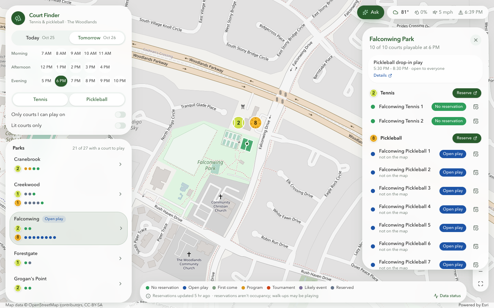
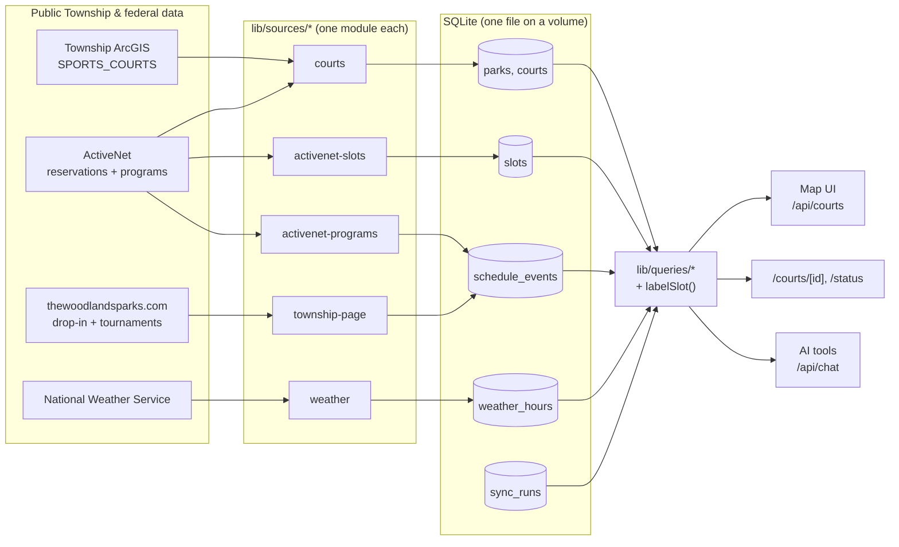

# Court Finder · The Woodlands

**Can I play now?** A live map of The Woodlands Township's public tennis and pickleball courts that combines GIS court outlines, ActiveNet reservations, published drop-in times, programs, and the weather, with an AI assistant that answers questions from the same data.



- **Map of all 27 parks / 104 courts:** tennis-ball and pickleball markers show how many courts you can play on right now (grey when none); zoom in for court outlines colored by status.
- **Labels that mean something:** *No reservation*, *Open play* (drop-in, anyone can join), *Program*, *Tournament*, *Likely event*, *Reserved*, *First come*. Drop-in play shows as "booked" in ActiveNet; this app knows the difference.
- **Pick any hour today or tomorrow** (residents can book 1 day ahead), filter by sport, playable-only, or lit courts; after-sunset hours are flagged on unlit courts.
- **Court day view** (`/courts/[id]`): one court's 7 a.m.–11 p.m. timeline with weather.
- **Data status** (`/status`): freshness of every source, and the data-quality findings from reconciling Township systems ([report](docs/reconciliation-report.md)).
- **Ask Court Finder:** Claude answers questions like "Any lit tennis courts without a reservation tomorrow at 8 PM?" using tool calls over the app's own queries.

## Architecture



**Rules that keep it simple**

1. **Sources never talk to each other.** Each `lib/sources/<name>/` folder fetches, validates (Zod), normalizes, and replaces its own rows in a transaction. Adding a source = a folder + one line in `lib/sources/index.ts`.
2. **The app reads only SQLite.** No upstream calls when a page loads or the assistant answers; a failing source just goes stale and shows red on `/status`.
3. **Joins by fixed rules, never fuzzy matching.** GIS ↔ ActiveNet match on park name + court number; anything that doesn't line up is kept and reported as a note.
4. **Labels are computed on read** by one pure, tested function (`lib/labels.ts`), so the map, pages and assistant can't disagree.
5. **Everything is keyed by Chicago-local date + hour.** Time zones are handled once, at ingest.
6. **Fail loudly.** Parsers are strict; an unexpected page or payload fails the run and keeps the last good data instead of guessing.

## Data sources

| Source | Data | Live schedule | Gentle schedule (dev) |
|---|---|---|---|
| `courts` | Township GIS `SPORTS_COURTS` + ActiveNet court list → parks, courts | daily | weekly |
| `activenet-slots` | Hourly reservation status, today + tomorrow (4 requests) | every 15 min, 7 a.m.–11 p.m. | every 3 h |
| `weather` | NWS hourly forecast | hourly | every 6 h |
| `township-page` | Pickleball drop-in times and tournaments (HTML) | daily | weekly |
| `activenet-programs` | ~170 lessons, leagues, clinics (≈180 requests) | daily | weekly |

All requests send an identifying User-Agent, are spaced ≥ 3 s per host, retry with backoff, and never touch anything behind a login. The `gentle` profile is the default outside production and skips boot-time fetches when data is under a day old.

## Running locally

```bash
npm install
cp .env.example .env.local     # set APP_CONTACT_URL; ANTHROPIC_API_KEY for the assistant
npm run sync                   # one-time: fills ./data/courts.db (takes a few minutes)
npm run dev                    # http://localhost:3000
```

`npm run sync -- --source weather` runs one source; `--dry-run` fetches and parses without writing. Set `SYNC_ENABLED=true` to let the app keep data fresh on its own.

```bash
npm test          # Vitest: parsers against saved real responses, labels, queries, assistant (mock model)
npm run typecheck
npm run lint
```

## Deploying on Dokploy

1. Create an **Application** from this repository with the **Dockerfile** build type.
2. Add a **volume** mounted at `/data` (the SQLite file lives at `/data/courts.db`).
3. Environment:
   ```
   SYNC_ENABLED=true
   APP_CONTACT_URL=https://github.com/<you>/woodlands-court-finder
   ANTHROPIC_API_KEY=...                 # optional: enables the assistant
   NEXT_PUBLIC_ARCGIS_API_KEY=...        # optional build arg: Esri light-gray basemap
   ```
   `NODE_ENV=production` selects the live sync schedules; set `SYNC_PROFILE=gentle` to stay slow.
4. Keep **one replica** (SQLite and the in-process scheduler assume a single instance). Port 3000; health check `GET /api/health`.

The image is about 500 MB and builds on a 2 GB host: the Docker build sizes Next.js workers to available memory and skips the in-build type check (`SKIP_BUILD_TYPECHECK=1`), which `npm run typecheck` covers instead.

The first boot runs every source once to fill the database (the programs crawl takes a few minutes), then follows the schedules.

## Project layout

```
app/                      pages and route handlers (/, /courts/[id], /status, /api/*)
components/explorer/      map view: ArcGIS map, floating panels, assistant
lib/sources/<name>/       one folder per data source: fetch, normalize, table, tests, fixtures
lib/queries/              the only code that reads the database
lib/labels.ts             what a court-hour means for someone who wants to play
lib/ai/                   assistant tools and system prompt
lib/sync.ts, scheduler.ts uniform run wrapper (sync_runs, errors) and node-cron scheduling
docs/                     reconciliation report, screenshot
```

## Limitations

- Reservation data is not occupancy: a court with no reservation may have walk-ups playing.
- Program locations are free text, so programs label every booked court of that sport at the park, not specific courts.
- The 19 dedicated pickleball courts have no GIS outline, so they appear in panels but not as shapes on the map.
- ActiveNet's endpoints are the ones its own public pages use, not a published API; the app validates every response and fails loudly if they change.
