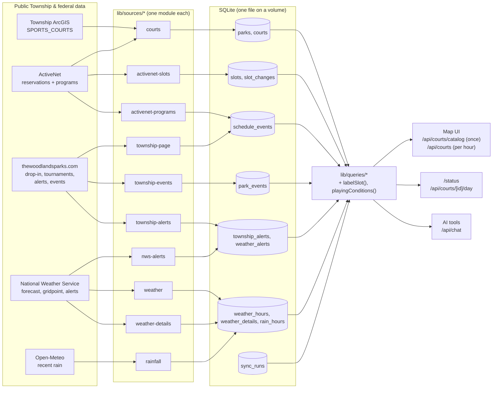

# Woodlands Court Finder

**Can I play now?** A live map of The Woodlands Township's public tennis and pickleball courts that combines GIS court outlines, ActiveNet reservations, published drop-in times, programs, Township closures and events, and the weather, with an AI assistant that answers questions from the same data.


- **Map of all 27 parks / 104 courts:** tennis-ball and pickleball markers show how many courts you can play on right now (grey when none); zoom in for court outlines colored by status.
- **Labels that mean something:** *No reservation*, *Open play* (drop-in, anyone can join), *Program*, *Tournament*, *Likely event*, *Reserved*, *First come*. Drop-in play shows as "booked" in ActiveNet; this app knows the difference.
- **Pick any hour residents can book:** tennis today through 2 days ahead, pickleball today and tomorrow (later pickleball days show "Booking not open yet"), filter by sport, playable-only, or lit courts; after-sunset hours are flagged on unlit courts.
- **Court day view:** open any court's full 7 a.m.–11 p.m. day beside the park panel, with weather; click an hour to move the whole map there.
- **Shareable links:** the time, park, court and filters live in the URL (`/?date=2026-10-26&hour=19&park=falconwing&sport=pickleball`), so a view can be shared, bookmarked or reloaded, and Back closes what you opened.
- **Alerts and conditions:** Township court closures and NWS warnings across the top of the map; per-hour warnings for wet courts (recent rain), thunderstorms, heat stress (WBGT) and gusts; Township events at a park (crowds, parking) in its panel. Conditions are warnings beside a court's label and never change it (`lib/conditions.ts`).
- **Data status** (`/status`): freshness of every source, and the data-quality findings from reconciling Township systems ([report](docs/reconciliation-report.md)).
- **Ask Woodlands Court Finder:** Claude answers questions like "Any lit tennis courts without a reservation tomorrow at 8 PM?" using tool calls over the app's own queries.

## Architecture



**Rules that keep it simple**

1. **Sources never talk to each other.** Each `lib/sources/<name>/` folder fetches, validates (Zod), normalizes, and replaces its own rows in a transaction. Adding a source = a folder + one line in `lib/sources/index.ts`.
2. **The app reads only SQLite.** No upstream calls when a page loads or the assistant answers; a failing source just goes stale and shows red on `/status`.
3. **Joins by fixed rules, never fuzzy matching.** GIS ↔ ActiveNet match on park name + court number; anything that doesn't line up is kept and reported as a note.
4. **Labels are computed on read** by one pure, tested function (`lib/labels.ts`), so the map, pages and assistant can't disagree.
5. **Everything is keyed by Chicago-local date + hour.** Time zones are handled once, at ingest.
6. **Fail loudly.** Parsers are strict; an unexpected page or payload fails the run and keeps the last good data instead of guessing.

## Data sources

| Source | Data | Live schedule | Gentle schedule (dev) |
|---|---|---|---|
| `courts` | Township GIS `SPORTS_COURTS` + ActiveNet court list → parks, courts | daily | weekly |
| `activenet-slots` | Hourly reservation status for each sport's booking window (tennis 3 days, pickleball 2; 5 requests) | every 15 min (:10, :25, :40, :55), 5 a.m.–11 p.m., plus 12:01 a.m. | every 3 h, plus 12:01 a.m. |
| `weather` | NWS hourly forecast | hourly | every 6 h |
| `weather-details` | NWS gridpoint: gusts, chance of thunder, heat index, WBGT, rain amounts | hourly | every 6 h |
| `rainfall` | Open-Meteo hourly rain that has fallen (a model estimate; nearby airports don't report hourly rain). Free for non-commercial use | hourly | every 6 h |
| `nws-alerts` | NWS watches, warnings and advisories for The Woodlands | every 15 min, 6 a.m.–11 p.m. | every 3 h |
| `township-alerts` | The announcement banner on thewoodlandsparks.com (closures); court-related ones are shown | every 30 min, 6 a.m.–11 p.m. | every 6 h |
| `township-page` | Pickleball drop-in times and tournaments (HTML) | daily | weekly |
| `township-events` | Events Directory: Township events at parks with courts, with start times (pages by ASP.NET postback; 2–3 pages + one request per matching event) | daily | weekly |
| `activenet-programs` | ~170 lessons, leagues, clinics (≈180 requests) | daily | weekly |

### History

Nothing that has happened is deleted, so the database builds up a record for future analysis (for example predicting how busy a court will be):

- `slot_changes`: every reservation status change seen between syncs, with when it was seen, so you can tell how far ahead hours get booked and how often they're released. `slots` keeps the last state of every past hour. ActiveNet reports an hour as taken once it can no longer be booked (an hour before it starts), so the sync ignores readings ActiveNet answered at or after that cutoff and keeps the last status seen before it (normally the :55 sync, 5 minutes before); the map shows those hours with their last known status, marked as too late to book.
- `weather_hours`, `weather_details`: the last forecast made for each hour; `rain_hours`: estimated rain that fell.
- `weather_alerts`, `township_alerts`: alerts with first/last seen times and `active`, so you can see how long a closure lasted.
- `schedule_events`, `park_events`: past drop-ins, programs, tournaments and Township events.
- `sync_runs`: every sync, with row counts and errors.

All requests send an identifying User-Agent, are spaced ≥ 3 s per host, retry with backoff, and never touch anything behind a login. The `gentle` profile is the default outside production and skips boot-time fetches when data is under a day old.

## Running locally

```bash
npm install
cp .env.example .env.local     # set APP_CONTACT_URL; NEXT_PUBLIC_ASSISTANT_ENABLED + ANTHROPIC_API_KEY for the assistant
npm run sync                   # one-time: fills ./data/courts.db (takes a few minutes)
npm run dev                    # http://localhost:3000
```

`npm run sync -- --source weather` runs one source; `--dry-run` fetches and parses without writing. Set `SYNC_ENABLED=true` to let the app keep data fresh on its own.

```bash
npm test          # Vitest: parsers against saved real responses, labels, queries, assistant (mock model)
npm run typecheck
npm run lint
```

## Deploying on Dokploy

1. Create an **Application** from this repository with the **Dockerfile** build type.
2. Add a **volume** mounted at `/data` (the SQLite file lives at `/data/courts.db`).
3. Environment:
   ```
   SYNC_ENABLED=true
   APP_CONTACT_URL=https://github.com/<you>/woodlands-court-finder
   NEXT_PUBLIC_ASSISTANT_ENABLED=true    # optional build arg: shows the AI assistant (off by default)
   ANTHROPIC_API_KEY=...                 # required when the assistant is enabled
   NEXT_PUBLIC_ARCGIS_API_KEY=...        # optional build arg: Esri light-gray basemap
   ```
   `NODE_ENV=production` selects the live sync schedules; set `SYNC_PROFILE=gentle` to stay slow.
4. Keep **one replica** (SQLite and the in-process scheduler assume a single instance). Port 3000; health check `GET /api/health`, which answers 200 whenever the database opens (an upstream outage never restarts the app) and reports `"status": "degraded"` when a source has failed or fallen behind its schedule, for an uptime monitor to alert on.

The image is about 500 MB and builds on a 2 GB host: the Docker build sizes Next.js workers to available memory and skips the in-build type check (`SKIP_BUILD_TYPECHECK=1`), which `npm run typecheck` covers instead.

The first boot runs every source once to fill the database (the programs crawl takes a few minutes), then follows the schedules.

### Beyond one instance

One container serves a township's worth of residents comfortably: every page and assistant answer is a local SQLite read. Running several would mean:

- **Sync once, not per replica:** move the scheduler into its own worker process (or take a lease row in the database before each run), so Township systems still see one polite client.
- **Shared data:** Postgres instead of the SQLite file (Drizzle and the queries carry over), or one writer replicating SQLite to read replicas with Litestream or LiteFS.
- **Shared rate limits:** the assistant's per-IP limit lives in memory; it would move to the database or Redis.

## How the app treats Township systems

The data comes from public pages and the JSON endpoints ActiveNet's own public pages call, read the way a resident's browser reads them: no logins, no bookings, nothing behind an account. Every request identifies the app and a contact URL in its User-Agent, requests to a host are spaced at least 3 seconds apart, the busiest source (reservations) makes a handful of requests every 15 minutes, and parsers fail loudly rather than guess when a page changes. The reconciliation report is written for the Township, and a published API or data feed would replace the scraping outright.

## Project layout

```
app/                      pages and route handlers (/, /status, /api/*)
components/explorer/      map view: ArcGIS map, floating panels, assistant
lib/sources/<name>/       one folder per data source: fetch, normalize, table, tests, fixtures
lib/queries/              the only code that reads the database
lib/labels.ts             what a court-hour means for someone who wants to play
lib/ai/                   assistant tools and system prompt
lib/sync.ts, scheduler.ts uniform run wrapper (sync_runs, errors) and node-cron scheduling
docs/                     reconciliation report, screenshot
```

## Limitations

- Reservation data is not occupancy: a court with no reservation may have walk-ups playing.
- Program locations are free text, so programs label every booked court of that sport at the park, not specific courts.
- The 19 dedicated pickleball courts have no GIS outline, so they appear in panels but not as shapes on the map.
- ActiveNet's endpoints are the ones its own public pages use, not a published API; the app validates every response and fails loudly if they change.
